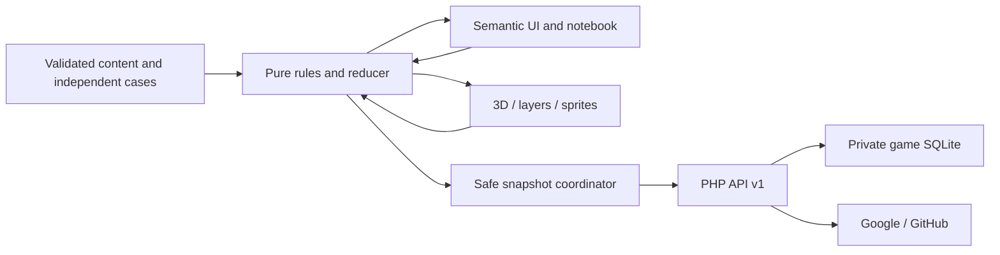

# Implementation Plan: Physical Layer / Underworld

**Branch**: `001-physical-layer-underworld` | **Date**: 2026-11-25 | **Spec**: [spec.md](spec.md)
**Input**: [Root PLAN.md](../../PLAN.md), the two accepted spec clarifications and [constitution v0.2.0](../../.specify/memory/constitution.md).
**Status**: Implementation initiated on 2026-11-25. See `docs/implementation/` for loop progress; runtime evidence G0–G7 remains outstanding.

## Summary

Deliver the complete first Network Quest episode as a standalone browser adventure: TypeScript, semantic HTML and interchangeable Three.js, layered-image and sprite presentations over one deterministic state engine. A dedicated PHP service on the existing GoDaddy host supplies Google/GitHub identity and one server-owned save per account. Media AI operates during production; gameplay consumes reviewed files.

Preserve twelve rooms, three independent repair routes, 25 modeled characters, 150 distinct modeled props (at least 50 interactive/evidence-bearing), nine recruits, four side quests, three minigames and every image/audio quota. Guests can continue in memory through the episode. Later realms wait for Spec001 acceptance.

Your clarifications govern implementation: canceled logout changes nothing; confirmed logout clears the adventure and returns to title without saving. Retry and E03 Continue rewind encounter/inventory preparation while retaining clues, personal notes and hint-use history and marking prior-attempt measurements stale. Restore Save loads the persisted snapshot instead.

## Technical Context

**Language/Version**: T002/T008/T009 verified TypeScript7.0.2, Node26.13.1/npm11.20.0 and local PHP8.4.28/Composer2.11.3. npm/Composer exact locks and isolated installations pass. Loops016/019 verified remote CLI and web PHP8.4.28/PDO SQLite3.54.1, private storage, locking, consistent snapshots, outbound TLS and cron; actual backup coverage/retention and release checks remain open. See [host evidence](../../docs/evidence/spec001/host.md); historical shell failures are superseded, not erased.
**Primary Dependencies**: Vite 8.3.8, Three.js/@types 0.187.0, Vitest 5.1.2, Playwright 1.65.1, axe-core/Playwright 4.14.1, Ajv 8 with ajv-formats (Draft 2020-12); PHP google/apiclient ^2.20, league/oauth2-client ^2.10, opis/json-schema ^2.6; development PHPUnit ^12.5. Exact direct/resolved versions are in package-lock.json and server/composer.lock. Local install/build/platform checks passed in [client evidence](../../docs/evidence/spec001/client-bootstrap.md) and [PHP evidence](../../docs/evidence/spec001/php-bootstrap.md); application behavior remains unimplemented.
**Storage**: Private dedicated PDO SQLite, rollback journal initially, foreign keys and short transactions; never analytics storage. No durable browser adventure drafts. Revalidate a same-host transactional alternative if SQLite fails G0.
**Testing**: Independent T01–T16 and state fixtures, schema/graph checks, API/concurrency/migration tests, browser automation, actual Safari/provider/source/visual/listening/learning/owner reviews.
**Target Platform**: Desktop/laptop including actual Mac Safari; current and previous supported major Safari/Chromium/Firefox at release, exact versions recorded. Responsive 768/390 px controls do not establish mobile performance support.
**Project Type**: Standalone static client plus same-origin PHP API; no production Node server or closed website dependency.
**Performance Goals**: Shell ≤5 MiB compressed; first room ≤15 MiB; interactive ≤12 s at 20 Mb/s/50 ms; ordinary exploration ≥30 FPS; provisional ≤500,000 visible triangles and ≤128 MiB estimated texture residency; save p95 <2 s with 20 mixed active sessions.
**Constraints**: Existing host; one account slot; separate preferences; autosave initially off; original world/editable media; no runtime AI or player keys; owner-initiated build/release.
**Scale/Scope**: Complete 60–120 minute main adventure: 12 rooms, 25 models, 150 props, 36 scene layers, 25 portraits, 24 illustrations, 8 music cues, 12 ambiences, 40 effects, 60 selected voice lines.
**Episode / Work Package**: Spec001, W01–W09/G0–G7; no Spec002–007 implementation.
**Content / Save Versions**: Planned initial episodeId spec001, contentVersion 1.0.0, saveSchemaVersion 1, API v1; stable episode-qualified IDs and explicit migrations.
**Media / Provenance**: Blender 5.2 LTS → GLB/renders/sprites; actual OpenAI imagery; Audacity 4 .aup4/lossless masters; Kokoro and ACE-Step 1.5 audition candidates, with component/output rights review.
**Measurement Profile**: G0 records host/software and Mac hardware/free space; G3 freezes laptop, exact browsers, 1280×720/1440×900, network shaping, cold/warm cache and worst scenes. Targets are unmeasured.

## Constitution Check

PASS denotes design conformity, never completed runtime evidence. Pre-research assessment used root contracts; post-design assessment includes the artifacts below.

| Gate | Requirements | Before research | After design |
| --- | --- | --- | --- |
| Purpose and scope | C1/C3/C7/C8 | PASS: complete beginner Physical episode | PASS: all quantities/three routes/shared state; AC01/02/08/18 |
| Agency and teaching | C4/C9/C10 | PASS: four verbs/inspectable outcomes | PASS: semantic actions, packet view, equivalent tools, retained learning; AC03–07/21 |
| Rule correctness | C10 | PASS: independent fixtures before rules | PASS: declared models, four statuses, source/profile gates; T01–T16/AC03 |
| Media and reuse | C5/C11/C13 | PASS: genuine sources/full quotas | PASS: source/export/use/provenance and actual review; AC08–10/16, production pending |
| Identity and saves | C6/C12 | PASS: guest/two providers/one slot | PASS: conditional/idempotent writes, SAVE01–13 and clarifications; AC11–13/17 |
| Access/performance | C14 | PASS: semantic controls/measured budgets | PASS: recovery, real Safari and manual review; AC14/15/20 |
| Distribution/privacy | C2/C6/C12/C13 | PASS: public build/existing host | PASS: dedicated data and scoped release/recovery; AC16/17/19 |
| Evidence/sequencing | C3/C14/C15 | PASS: gates and owner acceptance | PASS: traceability, no implicit build/publication/next episode; AC01–21 |

No exception or unresolved product clarification. Failed execution prerequisites block dependent work until a compliant alternative is documented; design PASS cannot waive them.

## Architecture



Pure evaluators return status/reason/observations/effects; a single reducer applies validated effects once. Content registries define stable IDs, reviewed rules and the O01→O02 opening, independent O03/O04 or O05/O06 or O07/O08 routes, common O09/O10, then O11/O12. Optional rewards and future realms cannot gate completion.

One action bus serves keyboard, pointer, touch and semantic object lists. Rendering and R01/R12 packet journeys read authoritative state; animations cannot grant progress. Checkpoints capture reversible world preparation separately from retained learning. Retry advances attempt identity and invalidates previous measurements.

The persistence coordinator serializes writes, retains exact request bytes while outcomes are unknown and rejects late responses from an earlier account generation. Authenticated retained receipts are resolved before current schema/content/safe-state policy, with a final transaction recheck before returning any provisional validation error. Deletion has a separate read-only, 24-hour receipt status so session absence never proves deletion. Replacement consent binds the adventure and reviewed server revision. PHP routes share strict validation, server-owned identity, transactional saves and migrations.

Load/dispose resources by room, bound neighboring prefetch and reference-count shared assets. R01 demonstrates 3D, R05 layers with real-time assets, R04 Blender sprites. Missing WebGL2/art/audio preserves semantic play and honest evidence.

## Phase 0: Research

[research.md](research.md) consolidates the required parallel browser, identity/storage and media research: decisions, alternatives, primary sources and observations. All design unknowns have a selected approach and validation condition.

W01/G0 must still execute host/private-storage/HTTPS/locking/backup checks, dependency resolution, real provider registrations/callbacks, teaching source review, Blender/Audacity reopen/export and local music/TTS feasibility. These are implementation evidence gates, not unanswered product questions.

## Phase 1: Design Artifacts

- [data-model.md](data-model.md): content/runtime/account entities, retained learning and migrations.
- [game-api.openapi.yaml](contracts/game-api.openapi.yaml): nine operations for session/auth/logout/save/preferences/deletion and receipt-authorized deletion status.
- [save.schema.json](contracts/save.schema.json): bounded v1 snapshot without client-owned account/revision/time.
- [asset-manifest.schema.json](contracts/asset-manifest.schema.json): source/export/provenance/use/review.
- [gameplay.md](contracts/gameplay.md): authoring, rules, interaction, retry/logout and safe persistence.
- [delivery.md](contracts/delivery.md): media audit, public build, website boundary and recovery.
- [quickstart.md](quickstart.md): future setup and command meanings.

Schemas provide structural checks; graph/reference/safe-state/provenance/quota validators remain required. Design examples are not running-service evidence.

## Phase 2: Sequence for Task Generation

The generated [tasks.md](tasks.md) groups work by story and provides an authoritative execution table across those groups. The implementation workflow follows those batches and dependencies; it does not require finishing a story section before a prerequisite batch in another section. Implementation is owner-authorized. Follow the owner-directed local continuation rule in tasks.md while keeping unverified aggregate gates open.

| Package / Gate | Dependencies and deliverable | Exit evidence |
| --- | --- | --- |
| W01/G0 | Host/provider/source/dependency/media audit, actual versions/licenses/private paths; T008–T011 local dependency/configuration/license/HTTPS preparation supplies working locks before final T007 reassessment | Observed/tested/unavailable capability matrix; independent cases; critical feasibility resolved before aggregate G0 PASS; independent T012/local foundation may proceed on verified local prerequisites |
| W02/G1 | Applicable W01 checks; shell/four verbs/R01–R02/notebook/T01/T02/T14 and boundary/packet view | Actual browser and keyboard interaction; independent evaluator and payload checks |
| W03/G2 | W02; content graph, inventory/notebook/compendium, identity/save and migration harness | SAVE01–13, real competing connections/lost responses; actual providers separate from mocks |
| W04/G3 | W02/media feasibility; finished representative room, real Blender/OpenAI/animation/audio | Source reopen, render/browser/listening/performance and owner review before bulk production |
| W05/G4 | W03/W04; prove one complete route with temporary geometry, then all routes/market/Clockworks/twelve rooms | Independent completion, reviewed mandatory cases; temporary art does not count |
| W06/G4 | W05/shared state; recruits/SQ01–04/MG01–03/Rift/R12/endings/retry | Alternatives, exits, preparation and rollback without item/reward duplication |
| W07/G5 | W04 benchmark/stable IDs; media batches may parallel W05/W06 | Full distinct sources/exports/use/credits and model/image/audio quotas; visual/listening checks |
| W08/G6 | W05–07; regression/access/performance/security, beginner/technical review, fixes | AC01–21 except final release operations; actual human evidence and owner satisfaction |
| W09/G7 | W08; public build/package, same-host staging/recovery drill, owner-initiated release | Source retrieval/provider/save/isolation/recovery/deletion; unaffected other games/analytics |

## Verification and Delivery Evidence

Future `docs/evidence/spec001/` records requirement, package, exact commit/content/asset hashes, environment, procedure, observed result, reviewer and defects. Pending checks stay pending. Exact AC/SAVE definitions remain in the spec.

| Requirements | Work | Acceptance |
| --- | --- | --- |
| FR-001/003/019/020; NQ-01/04 | W02/W03/W08 | AC01/04/14: four verbs, clues/staleness, keyboard/text/zoom/touch |
| FR-002/004/005; NQ-02/03 | W01/W02/W05/W08 | AC02/03: three routes, T01–T16, boundary/transfer/source cases |
| FR-006; NQ-13 | W02/W06/W08 | AC21: 0x4E 0x51 → 01001110 01010001; toy mapping and actual repair state |
| FR-007/008; NQ-05/06/07 | W03/W06/W08 | AC05/06: 25 entries, nine recruits/max two active, four side quests/three minigames |
| FR-009/010; NQ-08 | W03/W06/W08 | AC07/12: all endings, retry vs Restore Save, retained learning/stale readings |
| FR-011/012/013/014; NQ-10/11 | W03/W08 | AC11/12: real providers, SAVE01–09/13, adoption/opt-in/concurrency/replay |
| FR-015/016 | W03/W08/W09 | AC12/17: SAVE10/12/13, identity/CSRF/replay, logout/deletion/retention |
| FR-017/018; NQ-09 | W04/W07/W08 | AC08/09/10: complete distinct media, native sources/generated lineage/listening |
| FR-021/022 | W02/W04/W08 | AC14/15/20: recovery, exact browser/load/performance results including failures |
| FR-023/024 | W01/W07/W09 | AC16/17/19: independent build/rights/secrets/same-host isolation/recovery |
| FR-025; NQ-12 | W03/W08/W09 | AC13: future-door/ID/safe-position migration; newer saves untouched |
| FR-026; C1–C15/interviews mapped in spec | W08/W09 | AC18/full AC01–21: human/content/media/owner acceptance and sequencing |

Use isolated test databases, independent sessions/connections, save-vs-logout/deletion races, replay older than current slot, committed-write retry after changed content/schema policy, receipt appearing during validation, unsupported versions, lost deletion responses, expired/unknown receipt confirmation and post-deletion restore cases. Playwright WebKit supplements actual Safari; axe supplements manual accessibility review.

## Project Structure

These are future implementation paths; the planning artifacts already exist in this feature directory.

```text
src/domain/          # Pure physical evaluators
src/state/           # Reducer, checkpoints, journal, safe snapshots
src/content/         # Validated registries
src/ui/              # Semantic scene, verbs, notebook, account dialogs
src/presentation/    # Three.js, layers, sprites, audio
src/services/        # API and account generation
content/spec001/     # Rooms, objectives, dialogue, sources, independent cases
assets-src/          # Native media, prompts, provenance
public/assets/       # Runtime exports
server/public/       # API entry and scoped configuration
server/src/          # Identity, sessions, validation, repositories
server/migrations/   # DB changes
server/tests/        # Isolated API and concurrency tests
tools/               # Content/media/package validators
tests/               # Domain/state, browser, migration fixtures
docs/evidence/spec001/
```

One client/one small service fit the host. Adapters share gameplay; no generic plugin framework, microservices or replacement identity platform.

## Complexity Tracking

No constitutional violations/exceptions. Two runtimes follow the host constraint, three presentation modes follow media requirements, and transactions/migrations protect the sole save. Static-only persistence, unconditional last-writer-wins and bespoke per-room engines would fail those requirements.

## Planning Validation and Handoff

Validate schemas/examples, API/local references, links, requirement coverage and clarification invariants. Initial planning results are in research.md; task generation is complete in [tasks.md](tasks.md). Never run nonexistent game commands or mark G0–G7 complete. The owner has now initiated implementation; follow the execution table and durable loop handoffs.

The analysis findings and their document-level resolution are recorded in [analysis-remediation.md](checklists/analysis-remediation.md). G6 verifies its executable checks; G7 packaging/recovery/staging/publication rows remain pending until their dependencies exist. No gate is passed by this remediation.
