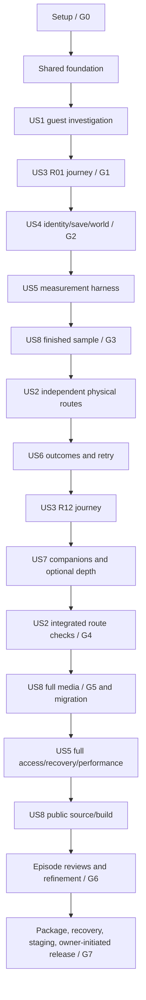

# Tasks: Spec001 — The Underworld (Physical Layer)

**Branch**: `001-physical-layer-underworld` | **Created**: 2026-11-25
**Input directory**: `/Users/john.capobianco/Network-Quest/specs/001-physical-layer-underworld/`
**Prerequisites**: [plan.md](plan.md), [spec.md](spec.md), [research.md](research.md), [data-model.md](data-model.md), [quickstart.md](quickstart.md), [API](contracts/game-api.openapi.yaml), [save schema](contracts/save.schema.json), [asset schema](contracts/asset-manifest.schema.json), [gameplay](contracts/gameplay.md), [delivery](contracts/delivery.md), [constitution](../../.specify/memory/constitution.md), [root SPEC.md](../../SPEC.md) and [root PLAN.md](../../PLAN.md).
**Status**: Implementation initiated by the owner on 2026-11-25. Task checkboxes record scoped completion; runtime gates are tracked separately in `docs/evidence/spec001/gates.md`. Loop progress and handoffs live in `docs/implementation/`.

## How to execute this checklist

Sections group work by the spec's user stories and priority (US1–US6 P1, US7–US8 P2). **Task IDs encode the recommended execution sequence; the execution table below is authoritative.** Some IDs resume in another story section because G1 needs US3's opening, G2 needs US4, and G3 needs US8's benchmark before full US2 gameplay. Read the whole dependency table; do not execute the story sections as an unconditional top-to-bottom sequence.

The local speckit-implement workflow uses this explicit batch order, with phase order only as a fallback for task lists without an execution table. Every task uses `- [ ] Tnnn [P?] [USn?] description with file paths`. Paths inside tasks are exact repository-relative targets rooted at `/Users/john.capobianco/Network-Quest/`; most are future files. Only story tasks have [USn]. IDs are unique and consecutive in execution order. No implementation task is checked by document validation. Retained save acknowledgements precede current semantic policy; lost deletion responses require operation-specific status, never an inference from guest authentication.

A batch begins after its actual local prerequisites are verified. External checks block the work that depends on them, not unrelated local implementation. Within a ready batch, non-[P] tasks run in listed order except for the explicit preparation order below. A consecutive [P] wave can run together **after the preceding task completes**, with separate files and isolated test storage; join the wave before the next serial task. An unavailable prerequisite is not permission to claim a pass. Preserve failed/unavailable evidence and continue only work whose actual prerequisites are satisfied.

Within the Project setup and G0 feasibility batch, T001 precedes the T002–T006 audit wave. After T002's local runtime check passes, T008 may initialize only the build/dependency bootstrap; T009 and T010 follow T008 with separate files; T011 follows their completion. These local G0 tasks may proceed while T003–T005 retain named open evidence. T007 may record an interim blocked assessment; its final G0 decision follows completion of T001–T006 and T008–T011. T012 may start after T001/T002/T006/T008–T011 and T005 technical feasibility pass locally. T003/T004 and human T005 evidence remain open. No aggregate gate is passed by this local execution exception. Stable task IDs do not override this explicit first-batch dependency exception; no [P] marker waives the gate. This 2026-11-25 ordering correction supplies the working-lock evidence required by the plan without changing any acceptance criterion.

**Owner-directed continuation, 2026-11-25:** the owner instructed “proceed only stop if its urgent” and then challenged the blanket stop. Continue reversible local implementation using verified actual prerequisites. A pending external subcheck does not prevent independent work in the next batch; record the specific dependency before deferring any task. Preserve the G0→G7 acceptance sequence: no gate PASS, real-provider success, production-media acceptance or release is inferred. Host execution/storage/retention must pass before host-dependent integration; real provider configuration before live flows; human auditions before voice/music acceptance; benchmark approval before bulk media; publication still requires owner initiation. Source-backed rules, isolated tests, complete episode scope and one-save guarantees are unchanged. Historical loop009/014 blanket-stop recommendations are superseded by this execution clarification. See `docs/implementation/execution-direction.md`.

A completed task records its scoped result; it does not certify an entire acceptance criterion whose remaining integration/media/human checks occur later. All eight stories remain required for release. The first playable guest increment is not the complete episode: retain 12 finished rooms, 25 models, 150 props, ≥50 interactive/evidence props, 36 room layers, 25 portraits, 24 illustrations, 8 music cues, 12 ambiences, 40 effects and 60 selected voice lines.

## Execution sequence and gate dependencies

| Order | Batch | Task IDs | Required preceding batch | Gate / purpose |
| --- | --- | --- | --- | --- |
| 1 | Project setup and G0 feasibility | T001–T011 | None | Shared |
| 2 | Shared types, data validation and harnesses | T012–T021 | T001/T002/T006/T008–T011; T005 technical feasibility | Shared; external G0 evidence stays open |
| 3 | Guest investigation implementation | T022–T030 | T012–T021 | US1 |
| 4 | R01 packet slice required for G1 | T031–T034 | T022–T030 | US3 |
| 5 | Playable diagnostic checkpoint | T035 | T031–T034 | US1 |
| 6 | Identity, single-slot persistence and G2 | T036–T058 | T035 | US4 |
| 7 | Measurement harness needed by the art benchmark | T059 | T036–T058 | US5 |
| 8 | Shared media benchmark and G3 before full production | T060–T067 | T059 | US8 |
| 9 | Physical evaluators and first complete route | T068–T078 | T060–T067 | US2 |
| 10 | Remaining independent repair routes | T079–T081 | T068–T078 | US2 |
| 11 | Outcomes, preparation rollback and retained learning | T082–T089 | T079–T081 | US6 |
| 12 | Repaired R12 packet journey | T090–T091 | T082–T089 | US3 |
| 13 | Companions, notebook depth and optional activities | T092–T104 | T090–T091 | US7 |
| 14 | Complete gameplay verification | T105 | T092–T104 | US2 |
| 15 | Complete media sources and exports | T106–T132 | T105 | US8 |
| 16 | Finished rooms, presentation modes and G5 | T133–T141 | T106–T132 | US8 |
| 17 | Expansion-safe progress and public source preparation | T142–T145 | T133–T141 | US8 |
| 18 | Complete accessible play, recovery and measured compatibility | T146–T155 | T142–T145 | US5 |
| 19 | Independent contributor verification | T156–T158 | T146–T155 | US8 |
| 20 | Whole-episode validation, refinement and scoped release | T159–T170 | T156–T158 | Shared |

This is a conservative valid execution order, not a claim that all stories have the same priority or are isolated codebases. Independent story tests use controlled prepared states; they do not require a player to finish every other route or optional quest. Broader parallel scheduling is allowed only when actual dependencies, gate evidence and file ownership permit it.

### Verified independent foundation scheduling

The coordinator may run T019's PHP-only router/disposable harness alongside T016:
its actual inputs are the accepted T009 Composer/runtime bootstrap and existing
API/storage contracts, not the client reducer, action bus or media adapters.
It owns separate server files. This uses the broader independent scheduling rule
above and the owner's continuation instruction. It does not complete T018, start
story work, enable a real account service, or pass a gate. Join T016–T020 and verify
all shared interfaces before T021; defer any discovered client-dependent wiring. T020 may
prepare its separate test configuration/command wiring concurrently, but must join
the actual T016/T019 interfaces before its final checks. It cannot label planned
story tests or pending evaluator TODOs as completed application coverage. T018 may
also start against T017's implemented and unit-verified restricted ActionDispatcher
port while DOM/browser checks finish, with separate presentation/test files and
an explicit final interface join. No T017 completion or gate pass is inferred.

### Verified independent guest scheduling

After T021 foundation acceptance, T024 may run alongside T022/T023: its pure copper/continuity/content-error evaluator depends on the accepted T006 source models and T014 independent cases, not new room prose or DOM wiring. It owns separate domain modules and physical-rule tests; T022 owns guest expectations and T023 owns authored content. Preserve tests-before-evaluation, do not alter independent expected answers, and join actual content/controller interfaces before guest integration or T030 acceptance. This scheduling does not complete any other guest task or pass G1.

T036 may also prepare independent save/auth/deletion expectations using the accepted
API/save schema, data-model and delivery contracts while guest content/controllers
are built. It owns only synthetic fixtures and their integrity checks. This neither
starts live provider flows nor claims G1/G2 or SAVE acceptance; actual account and
guest-promotion integration still needs the implemented interfaces and its checks.

T031's independent byte/bit/toy-symbol expectations may likewise be prepared from
T006/T014 and SPEC while guest controllers are built. Its fixtures do not require
the guest UI. Packet implementation and R01 integration still join the actual
physical state and controls before T034/G1 acceptance; no animation or fixture
can certify a working physical path.

T026 may build its separate dialogue state/UI/tests alongside final T025 browser
verification using the implemented `InteractionPlanner` and `GameplayStore` ports.
Coordinate any shared action-bus intents and browser registration through root;
join final interfaces before acceptance. This does not complete T025 or guest play.

T032 may implement the pure packet domain against accepted T024 physical results
and reviewed T031 expectations while guest controllers finish. It owns separate
domain files/tests and must retain incomplete/stale evidence rejection. R01 UI
activity still joins the actual guest controller state in T033/T034 before G1.

T027 may build notebook state/UI/tests alongside T026 dialogue and T032 pure
packet work using accepted T025 ports and T024 physical evaluation. Root coordinates
any shared reducer or bus changes; no separate task may edit them concurrently.
T028 may independently use the existing destination/canReachRoom reducer ports
and T025 WalkPlanner with separate navigation/scene-object files; T027 retains
shared reducer ownership. Join controllers with T029 before T030 guest acceptance.

T033 may build its isolated packet controls on accepted T032/domain and T017/bus
ports while T027/T028 finish. Coordinate bus intents through root. Actual R01
activity/save restrictions and guest composition still join in T029/T034 before G1.

T029 may compose the actual bootstrap against implemented T027 stable ports while
its final native checks finish, using disjoint title/tutorial/main files. T027
retains notebook/reducer ownership. Final guest acceptance waits for the joined
checks and T030, and packet activity remains T034.

T034 may prepare its separate packet activity adapter/tests on accepted T033 and
implemented T027 notebook/store ports while T029 finishes composition. It must use
actual R01 state/evaluation, acquire an unsafe activity lock and join T029 before
real introduction browser acceptance. Coordinate the app composition handoff; no
concurrent main edits or fabricated physical evidence.

### Verified independent local database scheduling

T037 may implement its isolated PHP database/migration boundary while T030/T035
finish the guest checkpoint. Its actual inputs are accepted T009 dependencies,
T019 private disposable-service harness, T036 independent storage expectations
and the current data/API contracts. It owns separate server files and uses only
synthetic private temporary databases. This does not enable auth/save routes,
start live provider flows, run a host migration, or pass G1/G2. Client/account
integration still joins the actual guest interfaces and required acceptance gates.

With T037 accepted, T038 may implement isolated session/security services against
that database and the existing T036 expectations while T035/G0 review remains
open. Its synthetic tests cannot authenticate real users or enable provider/save
routes. T041 owns route composition. Continue only on actual verified local
inputs; provider controls, human reviews and aggregate G1/G2 acceptance remain
required and cannot be inferred from these service tests.

T042's pure new-save validation may run independently of T038–T041 against
accepted T013/T015 schemas and content registry plus T036's prepared conformance
fixtures. It must keep client/server parity, distinguish current semantic policy
from stored-version reading, and return provisional results without HTTP writes
or bypassing T043's authorization/receipt-first transaction. It owns separate
validator/test files; real auth/save route composition and G2 still join later.

After T038 acceptance, T039/T040 may implement provider adapters with synthetic
HTTP/signature/identity tests against the verified local session/storage ports.
This does not start real provider flows or certify registrations/branding/grants.
T041 joins one-use transactions and route/session composition; the existing G0
provider controls and G2 separate-environment/actual-provider acceptance remain
mandatory. Keep external tokens out of persistence and all public/log outputs.

With T037/T038/T042 accepted, T043 may implement the isolated single-slot
repository on those actual database/session/provisional-validator interfaces and
T036 expectations while provider adapters and G1 review continue independently.
It must exercise receipt-first final authorization/atomicity in synthetic private
storage, without enabling HTTP routes or claiming real provider/client SAVE
acceptance. T044/T048–T057 still join routing, UI and actual provider evidence.

## Required verification and production rules

- Independently review scored-rule source/model/correct/incorrect/boundary cases before implementing evaluators. Keep the source fixture IDs T01–T16 distinct from checklist IDs T001 onward. Pending evaluator tests remain pending until implemented; no implementation-derived expected answers.
- Tests required by constitution/spec are mandatory. Record actual environment, content/code/asset hashes, procedure, result, reviewer and defects in the task's evidence path. Automated checks cannot certify a human playthrough, owner satisfaction, real-provider login or listening.
- Canceling logout leaves identity and adventure unchanged. Confirmed logout revokes the session, clears adventure/journal/checkpoint memory and returns to title without saving or deleting the slot. Retry/E03 Continue restore preparation/inventory, retain clues/notes/hint history and stale prior measurements. Restore Save loads the confirmed snapshot.
- Media production tasks preserve native .blend/.aup4 and lossless/raw generated sources, usable exports, actual output/known metadata, rights, and visual/listening evidence. Follow actual available image/audio skills when implementation reaches production; never fabricate a tool call. Public retrieval must work independently of private folders.
- Parallel production writes per-asset/per-batch records in its own subtree. Only the serial consolidation task edits the canonical manifest. A produced/exported item is not accepted until integration and required review are observed. Existing benchmark assets count once.
- A failed G0–G7 check blocks work that actually depends on that capability and prevents aggregate gate acceptance; it does not block independently verified local work. No count, schedule or [P] marker certifies an unverified check. Credentials and host inputs stay private. No automatic commits or release follow task completion.

## Phase 1: Setup — project initialization and G0

**Coverage**: W01/G0, C2/C5/C10/C12/C13; shared prerequisites for all eight stories.

**Purpose**: Establish real feasibility and a reproducible independent project. Complete each capability check before work that depends on it; keep aggregate G0 open until every required check passes. Missing host/provider/tool access is recorded as unavailable, never manufactured evidence.

### Project setup and G0 feasibility

**Ready after**: the owner initiates implementation.

- [X] T001 Create the requirement/evidence index and G0–G7 ledger in `docs/evidence/spec001/index.md` and `docs/evidence/spec001/gates.md`; map C1–C15/interview decisions to FR/NQ/AC IDs and keep all runtime results pending until observed.
- [X] T002 [P] Verify supported Node/PHP and candidate client/Composer versions from research.md, record actual platform/extension constraints and selected patches in `docs/evidence/spec001/runtime.md`; do not treat installed Node25 or package metadata as a successful build.
- [ ] T003 [P] Audit the existing GoDaddy game-only HTTPS routes, web/CLI PHP, PDO SQLite/library/filesystem locks, quotas, private paths, cron and actual backup retention in `docs/evidence/spec001/host.md`; document a same-host alternative if needed without touching analytics.
- [ ] T004 [P] Verify owner-controlled Google/GitHub registration prerequisites, exact callback routes and least-privilege settings in `docs/evidence/spec001/provider-preflight.md`; keep secrets outside source and mark unavailable real access explicitly.
- [ ] T005 [P] Run Blender/Audacity reopen-export smoke checks and local Kokoro/ACE-Step1.5 feasibility auditions, recording exact versions, memory/disk/runtime and inspected component/output rights in `docs/evidence/spec001/media-feasibility.md`; preserve actual smoke sources under `assets-src/feasibility/` without counting them as finished assets.
- [X] T006 [P] Create reviewed physical-profile source records in `content/spec001/sources.json` with title/URL/section/date/claim, fictional thresholds and model limits; attach independently calculated correct/incorrect/boundary expectations for every proposed scored rule in `docs/evidence/spec001/rule-source-review.md`.
- [ ] T007 Evaluate runtime/host/provider/media/source evidence and record G0 pass or specific blocked capabilities in `docs/evidence/spec001/gates.md`; resolve critical failures before dependent work and never fabricate readiness. Reassess after local setup supplies working locks; an interim BLOCKED decision is not final setup clearance.
- [X] T008 Initialize the planned TypeScript/Vite client and test dependencies with exact locks in `package.json`, `package-lock.json`, `tsconfig.json` and `vite.config.ts`; configure the nested game base, public API base and independent static build.
- [X] T009 [P] Initialize PHP8.4/Composer dependencies and PHPUnit with reviewed locks in `server/composer.json`, `server/composer.lock`, `server/phpunit.xml` and `server/config.example.php`; private data/config paths must be supplied outside docroot.
- [X] T010 [P] Add original-code/media license texts and contributor reuse rules in `LICENSE`, `LICENSE-ASSETS`, `NOTICE`, `CONTRIBUTING.md` and `.gitignore`; exclude secrets/player data/backups and document third-party notices plus public large-source retrieval.
- [X] T011 Document and implement local HTTPS/PHP startup with production-shaped same-origin paths in `README.md` and `tools/dev.mjs`; preserve Secure cookies and use isolated fixtures, never production data or weakened auth checks.

## Phase 2: Foundational — shared blocking prerequisites

**Purpose**: Provide common state/action/content contracts and isolated harnesses before any story implementation. Independent expected rule results precede evaluators; pending unimplemented rule suites cannot be labeled passed.

### Shared types, data validation and harnesses

**Ready after**: verified T001/T002/T006/T008–T011 and T005 technical feasibility; external G0 checks remain open under the owner-directed continuation rule above.

- [X] T012 Define qualified IDs, typed units, GameState/world/journal/transient-auth separation and four-status evaluator interfaces in `src/state/types.ts` and `src/domain/types.ts`, matching data-model.md and save v1 without client-owned account/revision/time.
- [X] T013 [P] Create room/objective/dialogue/profile/character/item schema definitions and the exact twelve-room/branch registry in `content/schemas/content.schema.json` and `content/spec001/world.json`; retain all original R/O/CH/PR/SQ/MG IDs and future-door boundaries.
- [X] T014 [P] Transcribe T01–T16 and independent per-rule correct/incorrect/boundary/invalid-input expectations into `tests/fixtures/physical-cases.json` and `tests/domain/physical-cases.test.ts`; manually check units/arithmetic against source review before any evaluator implementation.
- [X] T015 Implement schema/reference/quest-graph validation in `src/content/registry.ts` and `tools/validate-content.ts`; reject unknown IDs/units, impossible prerequisites, missing equivalents and optional/future dependencies using deliberate corruption cases in `tests/content/registry.test.ts`.
- [X] T016 Implement the deterministic command/reducer boundary, effect IDs, atomic transitions and configuration/attempt generations in `src/state/reducer.ts`; verify idempotent effects, interrupted transitions and essential-item recoverability in `tests/state/reducer.test.ts`.
- [X] T017 Build the shared semantic action bus and DOM shell in `src/ui/action-bus.ts` and `src/ui/app-shell.ts`; renderer, keyboard, pointer and touch must dispatch the same typed actions and never award progress independently.
- [X] T018 Define room presentation/audio adapters, resource ownership, bounded prefetch and disposal in `src/presentation/room-adapter.ts`, `src/presentation/resource-pool.ts` and `src/presentation/audio.ts`; expose a semantic fallback from the beginning.
- [X] T019 [P] Create the scoped PHP API entry/router and isolated test DB/TLS/session harness in `server/public/index.php`, `server/src/Router.php` and `server/tests/Support/TestEnvironment.php`; reject test-auth configuration in production and prevent destructive tests from targeting real storage.
- [X] T020 [P] Configure browser/domain checks and honest command wiring in `playwright.config.ts`, `vitest.config.ts` and `package.json`; implement check/test:domain/test:api/test:e2e/build against real suites, leaving unfinished release/media commands explicitly unavailable rather than returning false success.
- [X] T021 Run available type/content/reducer/harness checks and record foundation readiness in `docs/evidence/spec001/foundation.md`; verify no website source or runtime AI dependency and no story work starts with unresolved shared contract failures.

## Phase 3: User Story 1 — Begin investigating as a guest (P1)

**Goal**: Enter R01 without an account, learn four verbs and carry observations/hypotheses into R02.

**Independent test**: Fresh guest completes O01/O02, distinguishes power from link, uses four verbs, skips/replays dialogue safely and carries notes/evidence between rooms. Declining sign-in permits continued in-memory play.

**Coverage**: FR-001/003; NQ-01/04; AC01/04; W02/G1. The G1 checkpoint includes the early US3 packet slice.

### Guest investigation implementation

**Ready after**: T012–T021.

- [X] T022 [US1] Author prepared guest walkthrough expectations for O01/O02, dialogue skip/replay and evidence travel in `tests/fixtures/guest-investigation.json` and `tests/e2e/guest-introduction.spec.ts`, before wiring the interaction.
- [X] T023 [US1] Author the Arrival Lift and Titan's Workshop scenes, briefings and initial observations in `content/spec001/rooms/R01.json`, `content/spec001/rooms/R02.json` and `content/spec001/dialogue/introduction.json`; distinguish power from link and permit ongoing guest play.
- [X] T024 [US1] Implement declared copper/continuity and content-error evaluation needed by T01/T02/T14 in `src/domain/copper.ts` and `src/domain/evaluate.ts`; run the independent fixtures including exact-limit and malformed-profile cases before integrating scores.
- [X] T025 [US1] Implement Walk/Look/Talk/Use, helpful unsupported-action feedback, inventory selection/item combinations and visible W/L/T/U/I/N/C controls in `src/ui/verbs.ts` and `src/ui/inventory.ts`; required tools cannot be consumed irrecoverably.
- [X] T026 [US1] Implement skippable/replayable dialogue with effect-once completion in `src/state/dialogue.ts` and `src/ui/dialogue.ts`; skipped lines retain required clues and replays cannot duplicate items/objective rewards.
- [X] T027 [US1] Implement Objectives/Evidence/Hypotheses/Maps/Personal Notes with source/freshness, pinning and 4096-character plain-text notes in `src/state/notebook.ts` and `src/ui/notebook.ts`; distinguish observations, speculation and user writing.
- [X] T028 [US1] Implement room movement, safe authored positions and atomic arrival in `src/state/navigation.ts` and `src/ui/scene-objects.ts`; carry clues/hypotheses across R01–R02 and keep the semantic scene list equivalent to visual hotspots.
- [X] T029 [US1] Wire New Adventure/title/tutorial and a dismissible sign-in invitation in `src/ui/title.ts` and `src/state/tutorial.ts`; decline continues guest play without a durable-save claim and later New Adventure preserves replacement safeguards.
- [X] T030 [US1] Run guest and meaningful dialogue/inventory/measurement freshness cases in `tests/e2e/guest-introduction.spec.ts` and `tests/state/introduction.test.ts`; record keyboard/pointer R01–R02 results in `docs/evidence/spec001/US1.md` (AC01/AC04).

### Playable diagnostic checkpoint

**Ready after**: T031–T034.

- [ ] T035 [US1] Review the actual R01/R02 four-verb investigation and initial packet view, then record G1 and US1 acceptance in `docs/evidence/spec001/gates.md` and `docs/evidence/spec001/US1.md`; a useful guest increment does not waive remaining rooms/media.

## Phase 4: User Story 2 — Diagnose and validate a physical repair (P1)

**Goal**: Complete any copper/fiber/radio route with compatible equipment and fresh measurements.

**Independent test**: Seed a prepared Workshop state for each route; complete that route through R12 without other branches, future realms or optional rewards. T01–T16 and valid alternatives have the specified results; full ending verification follows US6.

**Coverage**: FR-002/004/005; NQ-02/03; AC02/03; W05/G4. Implement only after G3; prove one complete route before broadening room production.

### Physical evaluators and first complete route

**Ready after**: T060–T067.

- [ ] T068 [US2] Extend reviewed independent fixtures for every O03–O12 alternative/boundary and T03–T16 in `tests/fixtures/repair-routes.json` and `tests/domain/repair-routes.test.ts`; verify optical −11dBm/3dB, −13dBm/1dB, inclusive −12dBm/2dB and radio 25dB/13dB expectations before implementation.
- [ ] T069 [US2] Author bounded copper/fiber/radio/power/capability profiles with units, source references and fictional-threshold labels in `content/spec001/profiles.json` and `content/spec001/objectives.json`; every mandatory objective needs evidence, alternatives, effects and its method/worked/solution hint ladder.
- [ ] T070 [P] [US2] Complete copper compatibility/length/continuity/regeneration evaluation in `src/domain/copper.ts` against T01–T03 and boundary fixtures; a repeater cannot bridge the declared physical break.
- [ ] T071 [P] [US2] Implement optical profile compatibility, receive power/sensitivity/overload and reserve margin in `src/domain/optics.ts` against T04–T07/T15; retain dBm versus dB and reject incompatible optics before a passing numerical budget.
- [ ] T072 [P] [US2] Implement scoped path/channel/compatibility and SNR evaluation in `src/domain/radio.ts` against T08/T09 and independent boundaries; signal strength alone never promises throughput.
- [ ] T073 [P] [US2] Implement delivered-power allocation and common-capability selection in `src/domain/power.ts` and `src/domain/capabilities.ts` against T10/T11; 33W exceeds 30W by 3W and common capability is 100/full without inventing support.
- [ ] T074 [US2] Implement objective prerequisite/alternative evaluation, fresh-evidence validation and nonpunitive hint tracking in `src/state/objectives.ts` and `src/ui/diagnostics.ts`; T13/T14/T16 must reject stale/content errors and accept every technically valid solution.
- [ ] T075 [US2] Author Copper Warrens/Echo Cavern interactions and O03/O04 in `content/spec001/rooms/R03.json` and `content/spec001/rooms/R04.json`; use shared controllers, meaningful before/after evidence and recoverable conventional tools.
- [ ] T076 [US2] Author Shell Market/Clockworks and O09/O10 in `content/spec001/rooms/R09.json` and `content/spec001/rooms/R10.json`; distinguish form factor, PHY, medium, supplied power and signal timing, reusing the independently checked toy decoder.
- [ ] T077 [US2] Author branch-plan execution and fresh validation balcony interactions for O11/O12 in `content/spec001/rooms/R11.json`, `content/spec001/rooms/R12.json` and `src/state/repair-plan.ts`; reaching R12 alone must not award restored service.
- [ ] T078 [US2] Complete and verify a copper route from R01 through a valid R12 repair using temporary geometry for unfinished art in `tests/e2e/first-repair-route.spec.ts`; record the W05 complete-route checkpoint in `docs/evidence/spec001/first-route.md` before broadening room production.

### Remaining independent repair routes

**Ready after**: T068–T078.

- [ ] T079 [P] [US2] Author Photon Gardens/Prism Vault and O05/O06 in `content/spec001/rooms/R05.json` and `content/spec001/rooms/R06.json`; inspect connectors, match optics/fiber and explain fresh range/margin validation without requiring copper/radio progress.
- [ ] T080 [P] [US2] Author Skywell/Storm Observatory and O07/O08 in `content/spec001/rooms/R07.json` and `content/spec001/rooms/R08.json`; compare path/channel/noise observations and remeasure after mitigation without requiring another route.
- [ ] T081 [US2] Integrate all twelve authored rooms and exact walk/unlock edges in `content/spec001/world.json`; run graph tests for independent branches, reachable preparation, optional side paths and explicit unavailable Iron City boundary in `tests/content/world-graph.test.ts`.

### Complete gameplay verification

**Ready after**: T092–T104.

- [ ] T105 [US2] Run each copper/fiber/radio route independently through its valid ending, wrong/equivalent actions, all T01–T16 and remaining objective cases in `tests/e2e/repair-routes.spec.ts`; record AC02/03/21, all twelve playable rooms and G4 in `docs/evidence/spec001/US2.md` and `docs/evidence/spec001/gates.md`.

## Phase 5: User Story 3 — Experience a message as physical signals (P1)

**Goal**: Interactively follow the NQ payload through declared toy encoding, impairment and repaired reception.

**Independent test**: From controlled R01/R12 states, pause/step/replay by keyboard and pointer; visible bits and results agree with current physical state and upper layers remain clearly explanatory.

**Coverage**: FR-006; NQ-13; AC21; W02/W06. R01 is needed for G1; repaired R12 integration follows the actual outcome engine.

### R01 packet slice required for G1

**Ready after**: T022–T030.

- [X] T031 [US3] Independently author byte/bit/symbol/impairment expectations in `tests/fixtures/packet-journey.json` and `tests/domain/packet-journey.test.ts`: 0x4E 0x51 is 01001110 01010001; T12 is 00101101, with explicit toy-model limits.
- [X] T032 [US3] Implement deterministic encode/transmit/impair/decode journey steps in `src/domain/packet-journey.ts`; consume the current physical evaluator result rather than an independent cutscene success flag.
- [X] T033 [US3] Build pause/step/replay and semantic keyboard/pointer journey controls in `src/ui/packet-journey.ts` and truthful upper-realm context in `content/spec001/packet-context.json`; no seven invented headers or claim that two payload bytes are a full Ethernet frame.
- [X] T034 [US3] Integrate and verify the initial R01 message demonstration in `src/state/packet-activity.ts` and `tests/e2e/packet-introduction.spec.ts`; record observed message/result agreement in `docs/evidence/spec001/US3-introduction.md`.

### Repaired R12 packet journey

**Ready after**: T082–T089.

- [ ] T090 [US3] Connect the R12 journey to actual branch repair/impairment state in `src/state/packet-activity.ts` and `content/spec001/rooms/R12.json`; the apprentice and packet perspectives must agree after repair, retry and safe shutdown.
- [ ] T091 [US3] Run controlled R01/R12 keyboard/pointer pause/step/replay and mismatch cases in `tests/e2e/packet-journey.spec.ts`; obtain technical review of the payload, toy mapping and upper-layer caveats in `docs/evidence/spec001/US3.md` (AC21).

## Phase 6: User Story 4 — Save and resume one trustworthy adventure (P1)

**Goal**: Preserve one owned account adventure across devices, conflicts, expiry and deliberate logout/deletion.

**Independent test**: Run SAVE01–13 on known prepared states with both real providers and independent sessions, including older-content migration, lost responses and account isolation. Re-run unsafe encounter/logout interactions through US6's real UI later.

**Coverage**: FR-010–016; NQ-10/11; AC11/12/17; W03/G2. Mock providers do not pass AC11.

### Identity, single-slot persistence and G2

**Ready after**: T035.

- [X] T036 [US4] Author SAVE01–13, auth rejection, concurrency, schema and logout expectations in `server/tests/Fixtures/save-cases.json` and `tests/fixtures/save-conformance.json`; include committed-save retry after changed write policy, a receipt appearing during validation, and lost deletion responses with pending/completed/unknown/expired status. Retain the hypothetical older-content baseline in `tests/fixtures/save-migration-baseline.json`, unsafe/E03 states and clarified cancel/confirm behavior.
- [X] T037 [US4] Implement dedicated accounts/identities/sessions/auth_transactions/preferences/saves/receipts/migrations tables in `server/migrations/001_game.sql` and `server/src/Database.php`; enforce one slot/account, provider-subject uniqueness and private rollback-journal storage.
- [X] T038 [US4] Implement opaque Secure/HttpOnly/Lax host-only sessions, rotation, idle/absolute expiry, same-origin CSRF and redacted/rate-limited requests in `server/src/Sessions.php` and `server/src/Security.php`; GET session bootstraps guest CSRF without granting identity.
- [ ] T039 [P] [US4] Implement Google authorization-code/S256 and verified required iss/aud/sub/exp/iat/nonce checks in `server/src/Identity/Google.php`; request openid profile only, validate one-use session-bound state and discard provider tokens after identification.
- [ ] T040 [P] [US4] Implement GitHub GenericProvider/S256 with explicit empty scopes and GET /user stable numeric ID in `server/src/Identity/GitHub.php`; avoid email/repository access, implicit account merging and token persistence.
- [ ] T041 [US4] Implement POST auth start, GET callback and GET session in `server/src/Routes/Auth.php`; bind fixed callbacks, ten-minute one-use transactions and deletion reauth purpose, rotate sessions and emit only an origin-safe completion hint to the retained game tab.
- [X] T042 [US4] Implement strict Draft2020-12/format/registry/safe-state validation in `server/src/SaveValidator.php` and `src/services/save-validator.ts`; enforce 262144 UTF-8 bytes, 4096 Unicode note characters and bounded/known fields for new writes. Return provisional semantic errors to the coordinator; do not bypass receipt-first replay resolution.
- [ ] T043 [US4] Implement single-slot writes in `server/src/SaveRepository.php`: authenticate/bound requests, resolve retained account/key receipts before current semantic policy, validate still-new candidates outside the lock, then BEGIN IMMEDIATE and recheck authorization/receipt before returning a cached validation error or comparing revision. Fingerprint mode/confirmation/precondition/exact bytes; atomically write snapshot/revision/receipt and report committed versus current revision separately.
- [ ] T044 [US4] Implement GET/PUT save and conditional PATCH preferences in `server/src/Routes/Save.php` and `server/src/Routes/Preferences.php`; enforce create/replace headers, manual adoption, automatic opt-in/same-adventure checks and specified 401/403/409/412/413/422/428/429/503 responses.
- [ ] T045 [US4] Implement durable private deletion intents and 24-hour hashed receipt bindings outside DB rollback sets in `server/src/DeletionLedger.php`, `server/src/DeletionReceipts.php` and `server/src/AccountDeletion.php`; serialize with saves, mark completed only after live-data/session removal commits, reconcile both crash windows and retain longer-lived deletion markers independently of receipt expiry.
- [ ] T046 [US4] Implement POST logout, DELETE account and read-only POST account/deletion-status in `server/src/Routes/Account.php` and `server/src/Routes/DeletionStatus.php`; deletion needs fresh same-account auth/CSRF/confirmation and a 256-bit receipt. Status needs exact Origin plus only that narrow receipt, returns pending/completed/expiry or indistinguishable unknown/expired 404, exposes no account/progress and cannot delete or create an account. Logout remains slot-preserving.
- [ ] T047 [US4] Implement credentialed no-store API calls and account-generation response guards in `src/services/game-api.ts` and `src/services/account.ts`; retain the gameplay tab during popup/tab login and confirm identity using GET session, not postMessage contents.
- [ ] T048 [US4] Implement stable safe-snapshot construction, dirty generations and supported-version read/migration dispatch with the independently authored older-content baseline mapping in `src/state/snapshot.ts` and `src/state/save-migrations.ts`; never persist active encounters, E03/failure or partial transitions and preserve unsupported newer data.
- [ ] T049 [US4] Implement serialized conditional saves and exact-byte/idempotency retries in `src/services/save-coordinator.ts`; replay frozen pending requests without treating a changed new-write policy as proof of failure, acknowledge only the captured generation, reconcile older receipts against current slot and preserve memory on network/session failure.
- [ ] T050 [US4] Implement sign-in adoption, Continue/New Adventure warnings and explicit load/replace/cancel/conflict dialogs in `src/ui/save-dialogs.ts`; replacement binds the reviewed ETag and adventure, uses a new request ID and never merges or silently overwrites.
- [ ] T051 [US4] Implement opt-in account autosave and safe-boundary debounce in `src/state/autosave.ts`; first adoption is manual, opt-out suppresses queued writes, successful E01/E02 require safe Continue and no failed/E03 transition can write.
- [ ] T052 [US4] Implement provider display, plain saved-data/backup policy, deletion and clarified logout in `src/ui/account-settings.ts`; canceled logout changes nothing and confirmed revocation clears memory/title without saving. Retain the deletion receipt only in memory, show unconfirmed after response loss, poll read-only status with bounded backoff and confirm only DELETE 204/completed. Guest/unknown/expired status never proves deletion; do not automatically sign in or repeat deletion, and ignore results belonging to an earlier account view.
- [ ] T053 [P] [US4] Exercise malformed/oversized/Unicode/schema/ownership/CSRF and forged/expired/replayed state/nonce/signature/audience cases in `server/tests/IdentitySecurityTest.php` and `server/tests/SaveValidationTest.php`, and check all nine API operations/headers/status/body shapes in `server/tests/ApiContractTest.php`; prove isolation and absence of private data/receipt tokens in errors/logs.
- [ ] T054 [P] [US4] Use independent sessions/DB connections for conditional races, lost responses, key reuse/expiry, replay after a later revision and save-vs-logout/deletion in `server/tests/SaveConcurrencyTest.php`. Also commit/lose response/change schema-content write policy/retry: retained receipt succeeds once while the same old payload under a new key is rejected. Cover a receipt appearing during provisional validation and ensure revoked/wrong-account requests never read it.
- [ ] T055 [P] [US4] Test deletion-intent/live-commit/completion-marker crash windows, fresh same-account authorization, receipt binding/expiry/rate limits, wrong-Origin/unknown-token rejection and denied resurrection in `server/tests/AccountDeletionTest.php`; prove receipt-only checks cannot delete/sign in/read progress and that expired sessions cannot be mistaken for completed deletion. Use isolated storage only.
- [ ] T056 [US4] Run adoption/conflict/offline/session-expiry/autosave/close-and-restore/older-content cases in `tests/e2e/single-save.spec.ts`, canceled/confirmed logout in `tests/e2e/logout.spec.ts`, and lost DELETE response/pending/completed/unknown/expired status plus later-account response isolation in `tests/e2e/account-deletion.spec.ts`; record SAVE01–13 prepared-state results in `docs/evidence/spec001/US4.md` with no deletion success inferred from GET session.
- [ ] T057 [US4] Run actual Google and GitHub save/close/restore and cross-device account-isolation flows, including canceled/blocked popup recovery, and record non-secret results in `docs/evidence/spec001/real-providers.md`; mocks cannot pass AC11.
- [ ] T058 [US4] Recheck the full authored world graph and one-slot/provider evidence, then record G2 in `docs/evidence/spec001/gates.md`; distinguish prepared encounter/migration fixtures from later full-story UI coverage and leave unavailable real checks unverified.

## Phase 7: User Story 5 — Play through accessible controls and recoverable failures (P1)

**Goal**: Retain the same lesson with keyboard/text, muted audio, reduced motion, scaling and presentation/service failures.

**Independent test**: Complete a representative full route and ending via keyboard/text at 200% zoom, muted/reduced motion, then recover from lost WebGL/assets/audio/network. Verify 390/768px actions and actual browser/performance evidence.

**Coverage**: FR-019–022; AC14/15/20; W02/W04/W08. The measurement harness runs before G3; full access/performance acceptance uses final media.

### Measurement harness needed by the art benchmark

**Ready after**: T036–T058.

- [ ] T059 [US5] Implement cold/warm-load, frame/resource/disposal and 20-session save measurement harnesses in `tools/measure-browser.ts` and `tools/measure-save-load.php`; record exact device/browser/network profiles and every failed sample in `docs/evidence/spec001/measurement-profile.md`.

### Complete accessible play, recovery and measured compatibility

**Ready after**: T142–T145.

- [ ] T146 [US5] Author representative complete-route/ending keyboard, muted, reduced-motion, 200%-zoom, narrow-layout and failure expectations in `tests/e2e/accessibility.spec.ts` and `tests/e2e/recovery.spec.ts`; preserve the same required observations/actions.
- [ ] T147 [US5] Complete focus restoration, named scene/inventory/dialogue controls, text announcements and typing-safe shortcuts in `src/ui/accessibility.ts`; note entry cannot dispatch verbs and restored rendering retains the same focus/state.
- [ ] T148 [US5] Implement caption/text-scale/reduced-motion and separate music/effects/voice controls in `src/ui/settings.ts` and `src/ui/styles/accessibility.css`; persist signed-in preferences through the existing conditional API and keep guest settings in memory.
- [ ] T149 [US5] Implement 1280×720/1440×900 desktop and 768/390px touch layouts in `src/ui/styles/layout.css`; at 200% zoom all critical evidence/actions remain reachable without hover or precise pointing.
- [ ] T150 [US5] Complete failed asset/decode/audio/network and WebGL2/context-loss recovery in `src/presentation/recovery.ts`; offer retry/text/low-detail controls with identical gameplay state, bounded loading and honest unsaved status.
- [ ] T151 [US5] Pause presentation/audio on hidden tabs and resume safely in `src/presentation/visibility.ts`; no invisible mandatory timer, delayed effect or motion-dependent clue may change the lesson.
- [ ] T152 [US5] Run axe plus complete keyboard/text/muted/reduced-motion/zoom/touch and media/scene/network failures in `tests/e2e/accessibility.spec.ts` and `tests/e2e/recovery.spec.ts`; record manual focus/assistive checks and exact untested combinations in `docs/evidence/spec001/US5.md` (AC14/20).
- [ ] T153 [US5] Test actual current/previous supported major Safari, Chromium and Firefox at release, including real Mac Safari and all declared viewports, in `docs/evidence/spec001/browser-matrix.md`; Playwright WebKit is supplemental and narrow layout does not certify full mobile performance.
- [ ] T154 [US5] Measure final cold load, worst-room frames/resources/disposal and 20 mixed-session save latency using the recorded profile in `docs/evidence/spec001/performance.md`; check 5MiB shell/15MiB first room/12s/30FPS/500k triangles/128MiB estimated textures/p95<2s and report failed samples.
- [ ] T155 [US5] Resolve measured budget/recovery regressions in `src/presentation/resource-pool.ts`, export presets in `tools/asset-presets.json` and affected UI paths; retest changed scenes and record actual AC15/20 results in `docs/evidence/spec001/performance.md` without reducing required assets or readable evidence.

## Phase 8: User Story 6 — Reach an honest outcome and recover from failure (P1)

**Goal**: Distinguish permanent restoration, temporary restoration, unresolved shutdown and recoverable failure.

**Independent test**: From safe Rift preparation, exercise E01/E02/E03/failure; check commitment warnings, accurate caveats, unchanged recoverable save and clarified retry. Inventory rewinds while new clues/notes/hint history survive and readings become stale; Restore Save loads its snapshot.

**Coverage**: FR-009/010; NQ-08; AC07/12; W06/G4.

### Outcomes, preparation rollback and retained learning

**Ready after**: T079–T081.

- [ ] T082 [US6] Author independent E01/E02/E03 and failure expectations in `tests/fixtures/outcomes.json` and `tests/state/outcomes.test.ts`; distinguish permanent repair, valid temporary limitation and unresolved isolation, with no hint-based punishment.
- [ ] T083 [US6] Author preparation/consumption/reward/learning/freshness/Restore Save transition fixtures in `tests/fixtures/retry-transitions.json` and `tests/state/retry.test.ts`, including repeated retries and measurements whose old revision would otherwise look current.
- [ ] T084 [US6] Implement temporary encounter checkpoints and rollback in `src/state/encounter.ts`; restore world/inventory/party/effect flags together, retain clues/notes/hint history, allocate a fresh attempt generation and mark prior measurements stale without a second durable slot.
- [ ] T085 [US6] Implement paused preparation, deliberate commitment warnings and safe return controls in `src/ui/encounter.ts`; narrated danger cannot require reflex timing and conventional tools remain valid without a recruited ally.
- [ ] T086 [US6] Implement evidence-driven E01/E02/E03 classification and safe Continue locations in `src/state/outcomes.ts`; failure/E03 cannot produce a saveable world, and temporary/unresolved outcomes retain their precise caveats.
- [ ] T087 [US6] Author personalized route/ally/side-quest/maintenance epilogues and skippable dramatic failure explanations in `content/spec001/endings.json` and `src/ui/epilogue.ts`; assistance never turns a valid repair into a punitive ending.
- [ ] T088 [US6] Integrate Retry from Encounter Preparation, E03 Continue and distinct Restore Save in `src/ui/recovery.ts`; warn before discarding unsaved state, retain learning only for in-session retry and require ordinary safe saving for durability.
- [ ] T089 [US6] Run all outcomes, item/reward rollback, fresh-measurement and retry/restore tests plus autosave/logout races through the real UI in `tests/e2e/outcomes.spec.ts`; record AC07 and SAVE06/13 integration in `docs/evidence/spec001/US6.md`.

## Phase 9: User Story 7 — Recruit companions and explore optional depth (P2)

**Goal**: Provide 25 accurate compendium entries, nine recruitable allies, optional investigations and minigames.

**Independent test**: Prepared discovery states verify every recruit/progression/ability and conventional equivalent; each SQ01–04/MG01–03 starts, finishes/retries and exits independently. Two-allies maximum and optional rewards never gate a main route.

**Coverage**: FR-003/007/008; NQ-04/05/06/07; AC04/05/06; W06/G4.

### Companions, notebook depth and optional activities

**Ready after**: T090–T091.

- [ ] T092 [US7] Create independent ability/equivalent-tool and optional-activity completion/retry/exit expectations in `tests/fixtures/companions.json` and `tests/fixtures/optional-activities.json`; any new scored rule needs source/correct/incorrect/boundary review before its handler.
- [ ] T093 [US7] Author all CH01–CH25 roles, limitations, realm notes, recruitment/progression and portrait/source references in `content/spec001/characters.json`; preserve nine recruits (Photon, Copperhead, Unicorn, optical Hydra, Thunderbird, Hermit, Eel, Echo Bat, Chameleon).
- [ ] T094 [US7] Implement demonstrated recruitment, meaningful progression, max-two active allies and free preparation swaps in `src/state/party.ts` and `src/ui/party.ts`; abilities apply the same validated physical effects as conventional tools.
- [ ] T095 [US7] Build the illustrated discovered-entry compendium and cross-room evidence navigation in `src/ui/compendium.ts`; retain source/freshness and distinguish notes/hypotheses from fact, without exposing undiscovered content as completed.
- [ ] T096 [P] [US7] Implement Antique Serial Post SQ01 in `content/spec001/quests/SQ01.json` using R04 evidence and existing declared signal rules; deliver the optional illustration and safe exit without a required-route dependency.
- [ ] T097 [P] [US7] Implement Eel's Energy Audit SQ02 in `content/spec001/quests/SQ02.json`; reuse supplied delivered-power rules and award only the optional workshop decoration.
- [ ] T098 [P] [US7] Implement Skywell Weather Diary SQ03 in `content/spec001/quests/SQ03.json`; compare time-separated observations with honest freshness and unlock optional radio depth.
- [ ] T099 [P] [US7] Implement Lost Maintenance Record SQ04 in `content/spec001/quests/SQ04.json`; combine R03/R05/R09 notebook clues and personalize maintenance history without gating a main route.
- [ ] T100 [US7] Implement shared optional activity instructions/practice/explanation/retry/exit and default-off timing in `src/state/optional-activities.ts` and `src/ui/optional-activities.ts`; leaving or skipping never loses required items.
- [ ] T101 [P] [US7] Author Clockworks Bit Loom MG01 in `content/spec001/minigames/MG01.json`, reusing the toy decoder with untimed practice and no score requirement for O10.
- [ ] T102 [P] [US7] Author Prism Budget Bench MG02 in `content/spec001/minigames/MG02.json`, reusing reviewed optical rules after O06 with independent boundaries and no mandatory reward.
- [ ] T103 [P] [US7] Author Channel Scout MG03 in `content/spec001/minigames/MG03.json`, reusing scoped radio rules after O08 with predict/measure/compare explanations and safe exit.
- [ ] T104 [US7] Verify all 25 entries, nine recruits/progression/abilities, max-two party and conventional equivalents in `tests/e2e/companions.spec.ts`, and every SQ01–04/MG01–03 start/finish/retry/exit in `tests/e2e/optional-activities.spec.ts`; record gameplay evidence for AC05/06 and cross-room AC04, keeping portrait-dependent AC05 acceptance pending until final media/regression in `docs/evidence/spec001/US7.md`.

## Phase 10: User Story 8 — Explore a finished episode and retain progress through expansion (P2)

**Goal**: Deliver complete, reusable media and twelve finished rooms, preserved progress and independent public builds.

**Independent test**: Audit 12 rooms/25 distinct character models/150 props (≥50 interactive), image/audio quantities, actual native-source reopen and use; migrate hypothetical prior/future-door content and reproduce the build with public sources.

**Coverage**: FR-017/018/023–025; NQ-09/12; AC08/09/10/13/16/19; W04/W07/W09. Its early G3 benchmark enables US2; its later batches satisfy full G5 scope.

### Shared media benchmark and G3 before full production

**Ready after**: T059.

- [ ] T060 [US8] Author semantic manifest negative cases for duplicate identities, missing sources/rights/use, false acceptance, broken lineage and padded quotas in `tests/fixtures/asset-manifests.json` and `tests/content/assets.test.ts`; schema checks alone cannot certify review.
- [ ] T061 [US8] Implement source/hash/rights/lineage/usage/count validation and assets:verify in `tools/validate-assets.ts`; create the planned CH01–CH25, PR001–PR150 and image/audio identity allocations in `assets-src/manifest.json` without claiming any planned item accepted.
- [ ] T062 [US8] Define camera/palette/scale/animation/voice conventions and exact production/review records in `assets-src/art-direction.md` and `assets-src/audio/production-plan.json`; allocate 36 room layers, 25 portraits, 24 illustrations, 8 cues, 12 ambiences, 40 effects and 60 selected lines.
- [ ] T063 [P] [US8] Produce and reopen real R01 scene and Apprentice/Photon .blend sources with locomotion/idle/reaction clips, meaningful props and usable GLB exports in `assets-src/rooms/R01.blend`, `assets-src/characters/CH01.blend`, `assets-src/characters/CH03.blend` and `public/assets/models/`; record actual source/browser comparison.
- [ ] T064 [P] [US8] Generate actual OpenAI R01 background and two usable layers, preserve original prompts/references/output metadata and honest edits in `assets-src/images/R01/`, then export registered layers under `public/assets/images/R01/`; no fabricated invocation or private temporary references.
- [ ] T065 [P] [US8] Audition project dialogue for narrator/Titan/Photon/Hermit and representative AI-assisted music/effects in `assets-src/audio/auditions/`; retain raw generations, exact voice/model terms, Audacity4 .aup4/lossless masters and actual headphone/speaker listening records in `docs/evidence/spec001/audio-auditions.md`.
- [ ] T066 [US8] Finish R01 using real assets and shared interaction state in `src/presentation/three-room.ts` and `content/spec001/presentation/R01.json`; integrate music/voice/text/captions without changing diagnostic results or counting unaccepted smoke assets.
- [ ] T067 [US8] Measure the finished R01 reference room, reopen its sources, inspect actual browser rendering/listen and obtain owner review in `docs/evidence/spec001/representative-room.md`; record G3 in `docs/evidence/spec001/gates.md` before full gameplay/media scaling.

### Complete media sources and exports

**Ready after**: T105.

- [ ] T106 [US8] Freeze all twelve camera/walk/hotspot/occlusion layouts and at least fifty named interactive/evidence prop placements in `assets-src/rooms/scene-layouts.json`; reconcile per-asset production fragments against the exact source roster and approved G3 art/audio direction before parallel batches.
- [ ] T107 [P] [US8] Complete CH02 and CH04–CH09 (seven distinct models) with real reopened Blender sources, required idle/reaction/ability clips and GLB exports; record sources/rights/review/use in `assets-src/characters/batch-a.json`, preserving the already produced CH01/CH03 identities.
- [ ] T108 [P] [US8] Produce CH10–CH17 (eight distinct models) with real Blender sources, usable exports and required clips, recording source-reopen/render comparison and rights in `assets-src/characters/batch-b.json`; maintain each technical silhouette/role.
- [ ] T109 [P] [US8] Produce CH18–CH25 (eight distinct models), including one paired Crosstalk Twins identity, with required clips/native sources/exports/review in `assets-src/characters/batch-c.json`; no duplicate/recolor inflation.
- [ ] T110 [P] [US8] Complete PR001–PR020 for R01/R02, reusing accepted sample IDs, with the exact twenty named source props, reopened .blend/export files and production records in `assets-src/props/R01-R02/manifest.json`.
- [ ] T111 [P] [US8] Produce PR021–PR040, the twenty Copper Warrens/Echo Cavern props listed in spec.md, with distinct Blender sources/exports and inspected production records in `assets-src/props/R03-R04/manifest.json`.
- [ ] T112 [P] [US8] Produce PR041–PR060, the twenty Photon Gardens/Prism Vault props, with native source/export/rights/reopen evidence in `assets-src/props/R05-R06/manifest.json`; preserve physical compatibility/evidence landmarks.
- [ ] T113 [P] [US8] Produce PR061–PR080, the twenty Skywell/Storm Observatory props, with native source/export/rights/reopen evidence in `assets-src/props/R07-R08/manifest.json`; preserve inspectable signal/noise/path landmarks.
- [ ] T114 [P] [US8] Produce PR081–PR100, the twenty Shell Market/Clockworks props, with native source/export/rights/reopen evidence in `assets-src/props/R09-R10/manifest.json`; distinguish module form, power, timing and bits.
- [ ] T115 [P] [US8] Produce PR101–PR120, the twenty Rift/Iron Threshold props, with native source/export/rights/reopen evidence in `assets-src/props/R11-R12/manifest.json`; keep repair, warning and final-validation landmarks readable.
- [ ] T116 [P] [US8] Produce PR121–PR150, the thirty named shared tools/environment props, with native source/export/rights/reopen evidence in `assets-src/props/shared/manifest.json`; repeated room instances count once.
- [ ] T117 [P] [US8] Complete twelve usable generated scene layers across R01–R04 (background plus two layers each), retaining accepted R01 lineage, actual OpenAI outputs and camera/mask registration in `assets-src/images/rooms-01-04.json`; export corresponding public assets.
- [ ] T118 [P] [US8] Produce twelve usable generated scene layers across R05–R08 with actual prompts/references/output/edit lineage, alpha/depth registration and visual review in `assets-src/images/rooms-05-08.json`; derivatives must not be recorded as extra generation calls.
- [ ] T119 [P] [US8] Produce twelve usable generated scene layers across R09–R12 with actual source/metadata/registration and visual review in `assets-src/images/rooms-09-12.json`; no critical evidence may exist only in art.
- [ ] T120 [P] [US8] Generate and inspect thirteen distinct CH01–CH13 portraits with original source/prompts/rights and meaningful compendium references in `assets-src/images/portraits-01-13.json`; preserve approved character identity.
- [ ] T121 [P] [US8] Generate and inspect twelve distinct CH14–CH25 portraits with source/prompts/rights and compendium references in `assets-src/images/portraits-14-25.json`; portraits do not satisfy modeled-character counts.
- [ ] T122 [P] [US8] Produce the first twelve of the 24 allocated diagnostic/inventory illustrations, with actual production lineage and readable UI use in `assets-src/images/illustrations-01-12.json`; preserve technical units and equivalent text.
- [ ] T123 [P] [US8] Produce the remaining twelve diagnostic/inventory illustrations with distinct instructional purpose, source/rights and actual placement in `assets-src/images/illustrations-13-24.json`; decorative duplicates cannot fill the quota.
- [ ] T124 [P] [US8] Finish title/Workshop/copper/fiber music cues using the auditioned AI-assisted pipeline and original retro direction in `assets-src/audio/music-a.json`; retain raw production, .aup4/master/export lineage, loop/ending settings and actual listening findings.
- [ ] T125 [P] [US8] Finish radio/Clockworks/Rift/epilogue music cues in `assets-src/audio/music-b.json` with original source/AI disclosure/rights, .aup4/lossless/web exports and listened loop/ending/ducking behavior.
- [ ] T126 [P] [US8] Produce all twelve room ambience beds with purpose-specific identity, native mix/master/web export, loop metadata and listening records in `assets-src/audio/ambiences.json`; repeated files cannot count as different room sound designs.
- [ ] T127 [P] [US8] Produce twenty distinct allocated UI/movement/machinery/measurement effects with actual source/mix/master/export and listening evidence in `assets-src/audio/effects-01-20.json`; essential cues retain text equivalents.
- [ ] T128 [P] [US8] Produce twenty further distinct character/repair/failure/environment effects with source/mix/master/export and listening evidence in `assets-src/audio/effects-21-40.json`; record reused instances without inflating identities.
- [ ] T129 [P] [US8] Render and review selected voice lines 001–020 from the locked narrator/Titan/Photon/Hermit script plan in `assets-src/audio/voices-01-20.json`; retain exact script/caption, pronunciation, selected voice/model, raw generation and native mix/master/export.
- [ ] T130 [P] [US8] Render and listen to selected lines 021–040 with cast-consistent delivery and technical pronunciation in `assets-src/audio/voices-21-40.json`; record actual model/component rights and caption/in-game references.
- [ ] T131 [P] [US8] Render and listen to selected lines 041–060, including key outcomes and reactions, in `assets-src/audio/voices-41-60.json`; retain all provenance and intelligibility/performance findings before acceptance.
- [ ] T132 [US8] Validate and consolidate per-batch source/export/rights records into `assets-src/manifest.json`; reconcile exactly 25 modeled identities, 150 props, 36 layers, 25 portraits, 24 illustrations and all audio quotas without claiming runtime integration prematurely.

### Finished rooms, presentation modes and G5

**Ready after**: T106–T132.

- [ ] T133 [P] [US8] Complete camera-registered layered imagery, real-time characters/props and occluder handling in `src/presentation/layered-room.ts`; retain the shared semantic action/state model and low-detail equivalents.
- [ ] T134 [P] [US8] Implement Blender-rendered sprite atlas/frame timing/pivots and room composition in `src/presentation/sprite-room.ts`; validate source render settings against playback without inventing gameplay outcomes.
- [ ] T135 [US8] Finish native R01/R02 compositions and production placements in `assets-src/rooms/R02.blend`, `content/spec001/presentation/R01.json` and `content/spec001/presentation/R02.json`; preserve the real-time R01 benchmark and integrate all accepted scene audio.
- [ ] T136 [P] [US8] Finish R03/R04 native scenes and placements in `assets-src/rooms/R03.blend`, `assets-src/rooms/R04.blend` and `content/spec001/presentation/R03.json` and `content/spec001/presentation/R04.json`; export/review R04 sprite animation with matching interaction coordinates.
- [ ] T137 [P] [US8] Finish R05/R06 native scenes and placements in `assets-src/rooms/R05.blend`, `assets-src/rooms/R06.blend` and `content/spec001/presentation/R06.json` and `content/spec001/presentation/R05.json`; prove R05 layers plus real-time characters/props and preserve readable optical evidence.
- [ ] T138 [P] [US8] Finish R07/R08 native scenes and placements in `assets-src/rooms/R07.blend`, `assets-src/rooms/R08.blend` and `content/spec001/presentation/R07.json` and `content/spec001/presentation/R08.json`; align observation props, images and audio with current state.
- [ ] T139 [P] [US8] Finish R09/R10 native scenes and placements in `assets-src/rooms/R09.blend`, `assets-src/rooms/R10.blend` and `content/spec001/presentation/R09.json` and `content/spec001/presentation/R10.json`; keep form-factor/power/timing explanations visible in semantic controls.
- [ ] T140 [P] [US8] Finish R11/R12 native scenes and placements in `assets-src/rooms/R11.blend`, `assets-src/rooms/R12.blend` and `content/spec001/presentation/R11.json` and `content/spec001/presentation/R12.json`; match all outcome variants and packet validation to actual state.
- [ ] T141 [US8] Audit every finished room/source/export/placement and at least fifty interactive/evidence props, reopen Blender sources, inspect imagery/animation and listen to integrated cues/ambiences/effects/voices; record AC08–10 and G5 in `docs/evidence/spec001/media-audit.md` and `docs/evidence/spec001/gates.md`.

### Expansion-safe progress and public source preparation

**Ready after**: T133–T141.

- [ ] T142 [US8] Create explicitly hypothetical prior/future-door/renamed-ID/removed-position fixtures and independent preserved-state expectations in `tests/fixtures/migrations/spec001.json`; retain inventory, achievements, clues, notes, recruits, hint/outcome history without implementing Spec002.
- [ ] T143 [US8] Complete explicit content mapping/safe-position migration and player explanations in `src/state/save-migrations.ts` and `src/state/migrations/spec001.ts`; GET never rewrites storage and a migration is durable only through an eligible conditional save.
- [ ] T144 [US8] Test old-content/future-door migration, unknown newer preservation, interrupted migration and later safe saving in `tests/state/migrations.test.ts` and `tests/e2e/migrations.spec.ts`; record SAVE11/AC13 in `docs/evidence/spec001/migrations.md`.
- [ ] T145 [US8] Implement public versioned large-source retrieval and hash verification in `tools/fetch-sources.mjs`, `assets-src/source-index.json` and `docs/source-retrieval.md`; prove .blend/.aup4/raw/generated source availability without private website/player data.

### Independent contributor verification

**Ready after**: T146–T155.

- [ ] T156 [US8] Generate credits and complete third-party/source/output notices in `src/ui/credits.ts`, `THIRD_PARTY_NOTICES.md` and `docs/licenses.md`; preserve actual licenses/AI disclosure and verify no private inputs enter public artifacts.
- [ ] T157 [US8] Execute the documented setup/build/source retrieval from a clean isolated release-candidate copy using only public inputs; fix README/quickstart drift and record AC16 in `docs/evidence/spec001/independent-build.md`, distinguishing candidate reproducibility from later public availability.
- [ ] T158 [US8] Verify finished-room continuity, media/source availability and migration evidence together in `tests/e2e/finished-episode.spec.ts`; record US8 acceptance in `docs/evidence/spec001/US8.md` without treating it as permission to publish or advance realms.

## Phase 11: Polish & cross-cutting concerns — mandatory episode acceptance and release

**Purpose**: These checks are required, not optional polish. Integrated technical/beginner/owner review precedes G6; compatible staging/recovery and owner-initiated publication precede G7. Do not initiate Spec002–007.

### Whole-episode validation, refinement and scoped release

**Ready after**: T156–T158.

- [ ] T159 Run the G6-executable gameplay/content/media/access/security and SAVE01–13 regression cases on the integrated candidate; retain every AC01–21 row in `docs/evidence/spec001/acceptance-matrix.md`, but mark G7-dependent packaging/public-availability, operational restore/rollback, staging and production checks pending with their T164–T170 dependencies. Do not require or claim those unimplemented operations at G6.
- [ ] T160 [P] Have a technical reviewer inspect the implemented source/profile claims, characters, hints, packet journey and transfer cases; record concrete misconceptions/corrections and reviewer identity in `docs/evidence/spec001/technical-review.md`, leaving unavailable human evidence pending.
- [ ] T161 [P] Observe a networking beginner's unassisted/lightly assisted main run with timing, reasoning/hint/confusion notes in `docs/evidence/spec001/beginner-playthrough.md`; assess the 60–120 minute target without claiming learning from automated play.
- [ ] T162 Resolve release-blocking findings in their recorded source/content/asset files, retest affected behavior and track before/after evidence in `docs/evidence/spec001/refinements.md`; no task count or cosmetic workaround may close an unmet requirement.
- [ ] T163 Present the finished episode and unresolved findings for actual owner review, recording satisfaction and G6 in `docs/evidence/spec001/owner-review.md` and `docs/evidence/spec001/gates.md`; all G6 criteria must pass, while explicitly identified G7 operations remain pending. Do not fabricate approval, declare release readiness or begin another realm.
- [ ] T164 Implement package:release and version/code/content/API/save/DB compatibility metadata in `tools/package-release.mjs` and `release/manifest.schema.json`; check manifest/version compatibility and private-data exclusion in `tests/release/package.test.ts`, then produce checksummed standalone client/PHP/vendor/schema/credits/source-index artifacts excluding development secrets, DBs and backups.
- [ ] T165 Implement scheduled consistent encrypted backups, separate save-receipt/deletion-receipt expiry, redacted operational checks and isolated restore tooling in `server/bin/backup.php`, `server/bin/restore.php` and `docs/operations.md`; protect deletion markers/completion metadata outside rollback, retain markers through backup lifetime and validate actual retention/RPO/RTO.
- [ ] T166 Run isolated restore/migration/rollback drills for post-backup account deletion, pending/completed deletion markers, expired confirmation receipts, failed backup/commit, concurrent saves and compatible code rollback in `server/tests/RecoveryTest.php`; record preserved acknowledged progress and accurate deletion status in `docs/evidence/spec001/recovery-drill.md`.
- [ ] T167 Prepare and verify the game-only nested routes, private data boundaries, no-store API/cache policy and versioned website handoff on same-host staging; record provider/save smoke and unchanged arcade/analytics checks in `docs/evidence/spec001/staging.md` and `docs/deployment.md`.
- [ ] T168 Assemble the concrete artifact, rollback procedure and evidence index in `docs/evidence/spec001/release-readiness.md`; require all pre-publication checks from T164–T167 and earlier gates to pass, with only explicitly identified post-publication smoke checks pending. Stop before live publication until the owner initiates that stage.
- [ ] T169 Only after owner-initiated release, publish the reviewed version through the documented game-only boundary and verify public source retrieval, real providers/save/Continue and unaffected arcade/analytics; record exact deployment and any rollback in `docs/evidence/spec001/release.md`.
- [ ] T170 After T164–T169, complete the previously pending G7 checks and reconcile the full AC01–21 matrix in `docs/evidence/spec001/acceptance-matrix.md`; run destructive checks only in isolation and public smoke checks without harming player data. Record G7 in `docs/evidence/spec001/gates.md` only when every required result passes; retain failures and leave Spec002–007 for separate owner initiation.

## Constitutional and acceptance coverage

C7's interview trace is retained through the source spec and the evidence index; C15 governs every row. All paths below are under `docs/evidence/spec001/` and are future evidence, not existing passed results.

| Acceptance | Constitution / requirements | Principal tasks | Evidence files |
| --- | --- | --- | --- |
| AC01 | C1/C4; NQ-01; FR-001 | T030, T035 | `US1.md` |
| AC02 | C3/C8/C9; NQ-02; FR-002 | T078, T105 | `US2.md` |
| AC03 | C9/C10; NQ-03; FR-004/005 | T006, T014, T068, T105, T160 | `rule-source-review.md; US2.md` |
| AC04 | C4/C9; NQ-04; FR-003 | T027, T030, T104 | `US1.md; US7.md` |
| AC05 | C4/C9/C10; NQ-05/06; FR-007 | T093, T094, T104 | `US7.md` |
| AC06 | C4/C9; NQ-07; FR-008 | T092, T100, T104 | `US7.md` |
| AC07 | C9/C12; NQ-08; FR-009/010 | T083, T084, T086, T089 | `US6.md` |
| AC08 | C3/C5/C11; NQ-09; FR-002/017 | T106, T132, T141 | `media-audit.md` |
| AC09 | C5/C11/C13; FR-018 | T117, T118, T119, T120, T121, T122, T123, T141 | `media-audit.md` |
| AC10 | C5/C11/C13; FR-018 | T065, T124, T125, T126, T127, T128, T129, T130, T131, T141 | `audio-auditions.md; media-audit.md` |
| AC11 | C6/C12; NQ-10; FR-011/012 | T041, T056, T057 | `real-providers.md; US4.md` |
| AC12 | C6/C12; NQ-11; FR-010/012/013/014/016 | T036, T043, T051, T054, T056, T089 | `US4.md; US6.md` |
| AC13 | C8/C12; NQ-12; FR-025 | T048, T142, T143, T144 | `migrations.md` |
| AC14 | C14; FR-019/020 | T147, T148, T149, T152 | `US5.md` |
| AC15 | C14; FR-020/022 | T059, T067, T153, T154, T155 | `measurement-profile.md; performance.md; browser-matrix.md` |
| AC16 | C2/C13; FR-023/024 | T010, T145, T156, T157, T164, T169 | `independent-build.md; release.md` |
| AC17 | C12/C13; FR-015/016/024 | T053, T054, T055, T156, T159 | `US4.md; acceptance-matrix.md` |
| AC18 | C1/C3/C14/C15; FR-026 | T160, T161, T162, T163 | `technical-review.md; beginner-playthrough.md; owner-review.md` |
| AC19 | C2/C12; FR-023/025 | T165, T166, T167, T169, T170 | `recovery-drill.md; staging.md; release.md` |
| AC20 | C5/C14; FR-021 | T150, T151, T152, T155 | `US5.md; performance.md` |
| AC21 | C1/C10; NQ-13; FR-006 | T031, T034, T090, T091 | `US3-introduction.md; US3.md` |

SAVE01–13 are explicitly authored in T036, exercised with isolated services/browser states in T056, real providers in T057, actual encounter integration in T089 and the executable G6 regression in T159; G7-dependent evidence is completed/reconciled in T164–T170. SAVE11 receives additional migration coverage in T144; SAVE12 gets crash/restore coverage in T055/T166; SAVE13 has explicit cancel/confirm browser coverage in T056.

## Parallel execution examples by story

[P] is an opportunity after prerequisites, not a request to spawn agents now. The execution table gives a safe baseline; when only one task is ready, work serially.

| Story | Concrete independent work | Barrier / constraints |
| --- | --- | --- |
| US1 | Guest narrative fixture/content and notebook implementation are intentionally serial in this first slice | No [P] pair is claimed: they share the not-yet-stable action/state contract. Once accepted, rerun its separate tests with unique browser contexts alongside other ready checks |
| US2 | T070, T071, T072, T073 in distinct evaluator files; T079 and T080 in disjoint room files | First wait for T069; later room pair waits for T078; shared objective integration is serial |
| US3 | Packet model/UI/state integration is deliberately serial | Byte/symbol expectations precede implementation; R12 waits for real outcome state. After completion, R01/R12 browser checks can run in separate contexts without editing shared files |
| US4 | T039 and T040; later T053, T054, T055 | Session contract first; provider files separate. Each test worker owns an isolated DB/session namespace; independent race connections remain inside its test |
| US5 | Measurement harness precedes final UI work; compatibility checks can run across isolated browser processes after the UI stabilizes | No concurrent edits to shared focus/settings/resource files; actual Safari/manual review remain separate from automation |
| US6 | Outcome/rollback fixtures and shared state integration remain serial in this checklist | Both use preparation/revision semantics; do not claim a speculative parallel state edit. Independent accepted end-state browser cases can later use separate prepared sessions |
| US7 | T096, T097, T098, T099; then T101, T102, T103 | Shared fixture/schema/party work first; quest and minigame files are disjoint and reuse already-reviewed evaluators |
| US8 | T107–T131 production batches and T133/T134 | Approved G3/layouts first; independent asset identities/record files; T132 alone merges canonical records and scene integration waits for exports |

There are 66 [P] tasks in 15 explicit waves. Shared setup audits, separate service/browser harnesses and independent human reviews also have safe opportunities. A missing useful parallel pair for a story is recorded honestly rather than labeling dependent tasks [P].

## Implementation strategy and completion boundaries

1. **First increment:** complete T001–T011 and T012–T021, then US1's guest investigation and US3's R01 journey through T035. Verify the useful R01/R02 diagnostic before scaling. This is a playable increment, not release-complete Spec001.
2. **Trust and production benchmark:** prove actual identity/one-slot behavior at G2, build measurement tools, then obtain G3 source/visual/listening/performance/owner evidence on a finished room.
3. **Complete gameplay:** independently verified rules, one full route, other routes, all outcomes/retry, R12 packet view and companion/optional depth; close G4 with integrated route evidence.
4. **Finish the episode:** complete all required media and room compositions/G5; validate migrations, access/performance, source retrieval and independent contributor build. Lower-priority stories remain mandatory.
5. **Review and release:** G6-executable matrix rows, technical and beginner reviews, fixes and actual owner satisfaction/G6; then package, restore/rollback and scoped staging before completing the G7 rows. Publication occurs only after the owner initiates release. Close G7 from real evidence and leave later realms for a separate request.

## Task inventory and document validation

| Scope | Tasks |
| --- | ---: |
| Phase 1 | 11 |
| Phase 2 | 10 |
| US1 | 10 |
| US2 | 15 |
| US3 | 6 |
| US4 | 23 |
| US5 | 11 |
| US6 | 8 |
| US7 | 13 |
| US8 | 51 |
| Phase 11 | 12 |
| **Total** | **170** |

Pre-implementation document validation passed on 2026-11-25: all 170 then-unchecked task lines satisfy the checkbox/ID/optional-parallel/story/path format; execution IDs T001–T170 are unique and contiguous; eight story labels match their phases; all 20 execution batches have earlier prerequisites; 66 [P] tasks form 15 waves without duplicate explicit file targets. All 14 local links resolve. Coverage includes FR-001–026, SC-001–015, AC01–21, SAVE01–13, W01–W09 and G0–G7, with eight independent story-test criteria. No game implementation or runtime tests were started by that validation. The current implementation run is tracked in the task checkboxes and `docs/implementation/`; these earlier document checks are not passed implementation tasks. The authorized analysis remediation preserves all 170 IDs and adds the ninth API operation and its failure cases; see [analysis-remediation.md](checklists/analysis-remediation.md) for the completed validation. Optional Git hooks remain available as `/speckit.git.commit`; automatic commits are disabled. Analysis remediation is complete; the owner has initiated `$speckit-implement` with durable one-task loop notes.
